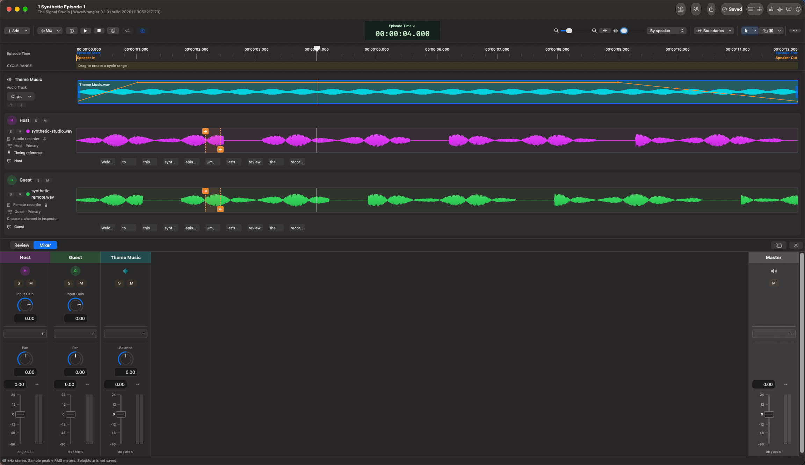

<p align="center">
  
</p>

# Your recordings. One conversation.

**WaveWrangler is a native macOS app for turning separately recorded podcast
tracks into an edited, mixed episode.** Bring your speakers together, review
the timing, shape the conversation, and add music without changing your
original recordings.



## From separate tracks to a finished episode

| What you want to do | What WaveWrangler provides |
| --- | --- |
| Keep a series organized | A Library of shows and episodes, collections, and dedicated episode windows. |
| Bring recordings into sync | Reviewed automatic alignment, manual anchors and timing adjustments, and adaptive file timing for changing delay. |
| Find and refine edits | Local Whisper transcripts, approximate word timing, filler review, synchronized cuts, and speaker-only mute regions. |
| Build an opening and closing | Supplemental Audio Clips, explicit intro/ripple insertion, trims, splits, fades, and graphical level automation. |
| Balance the conversation | Per-speaker input gain, Auto Input Gain, Audio Unit inserts, faders and pan, plus a Master strip. |
| Deliver the episode | Whole-episode WAV, MP3, and M4A/AAC-LC export, optional loudness normalization, and publication metadata and artwork. |

### Review the timing, rather than trust a guess

Recorders can start at different times, drift apart, or change delay during a
take. **Align Tracks** proposes timing for you to review; it never silently
accepts it. Use measured intervals, manual corrections, or adaptive timing
where appropriate, and listen before proceeding.

Adaptive timing distinguishes locally supported matches from estimated gaps
and ends. Retaining audio is not a claim that every moment is verified.
See [Alignment](docs/product/alignment.md).

### Edit the conversation without editing your originals

Transcribe assigned Primary tracks locally, listen to suggested fillers, and
adjust their boundaries before cutting. A synchronized cut removes time across
the spoken tracks; a speaker-only mute leaves everyone else's timing in place.
Review decisions alone do not cut audio.

Add a music bed or an outro as an Audio Clip. Ordinary placement overlays the
timeline; creating an intro or inserting time is a separate, previewed action.
See [Transcription and editing](docs/product/transcription-and-editing.md) and
[Audio Clips](docs/product/audio-clips.md).

### Hear the mix you intend to export

Select **Production Mix** in the control bar's **Mix/Source** menu, then press
Play to hear speaker Primaries, saved edits, Audio Clips, speaker processing,
and Master processing. Dock the mixer below the timeline or detach it.

Source audition is different: it helps compare recordings and timing, not
judge the finished mix. Backups are not automatically added to production.
See [Mixer](docs/product/mixer.md) and [Export](docs/product/export.md).

## A short first-session workflow

1. **Create a show and episode.** Keep show-wide publication defaults and
   episode-specific details together in Library.
2. **Add recordings.** Open **Recordings & Speakers**, review the import,
   assign speakers and channels, and choose each speaker's Primary.
3. **Align and listen.** Run **Align Tracks**, inspect the proposals, and
   explicitly accept the timing you want to use.
4. **Review and edit.** Download a model when you choose to, transcribe,
   audition words and selections, and make deliberate cuts or mutes.
5. **Add music and mix.** Place Audio Clips, shape fades, balance the speaker
   strips, and audition in **Production Mix** mode.
6. **Export.** Review Episode Start/End, choose formats and a destination,
   and check metadata before starting the whole-episode export.

Start with the [Getting started guide](docs/product/getting-started.md), or
browse the [user guide](docs/product/README.md).

## Your media stays yours

Original recordings are referenced in place, not rewritten. Imports explicitly
authorize audio use on this Mac; changed or unavailable sources require review.
Editing decisions live in the show document and support Undo/Redo.

Whisper inference runs locally. Model downloads happen only when requested;
recordings and transcripts are not uploaded for transcription. Recognition and
word timing are approximate, and every model can make mistakes.

**Saved** means the local show was verified on disk, not that a cloud provider
finished syncing it. Recovery offers and save failures remain visible.
See [Saving and recovery](docs/product/saving-and-recovery.md).

## Current availability

WaveWrangler is under active development. There are currently **no published
GitHub releases**; build from source to try it. The app targets **macOS 26 or
later on Apple silicon**. That is a development target, not a claim of
qualification across every Mac, OS version, recording format, or Audio Unit.
No App Store availability or distribution-readiness claim is made.

## Build and open locally

Use a Mac with Xcode supporting the macOS 26 SDK and Swift 6, with its command-line
tools selected. From a checkout:

```bash
WW_JOBS=4 WW_DERIVED_DATA="$PWD/.build/AppDerivedData" bash scripts/build.sh
open "$PWD/.build/AppDerivedData/Build/Products/Debug/WaveWrangler.app"
```

This makes an ad-hoc-signed development build, not a notarized download.
Keep this app's DerivedData separate from test builds, and quit it before
rebuilding its bundle. For installation, tests, and development setup, see
[Contributing](CONTRIBUTING.md) and
[Engineering getting started](docs/engineering/getting-started.md).

## Documentation and license

[Documentation](docs/README.md) connects the user and engineering guides.
First-party source is [MIT licensed](LICENSE). Third-party software and model
licenses remain separate; see the bundled notices and
[export codec licensing and rebuild instructions](docs/engineering/export-codecs.md).
