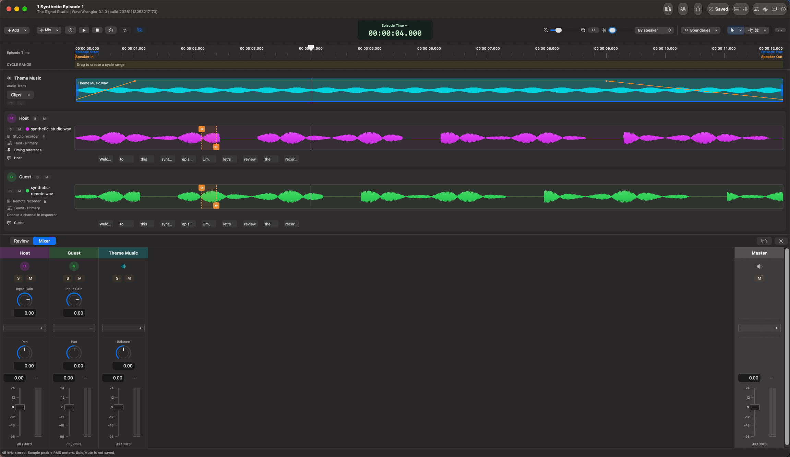

# WaveWrangler user guide

Prepare a podcast episode from separate recordings while keeping the original
media unchanged. WaveWrangler combines reviewed alignment, local transcription,
manual edits, supplemental audio, a production mixer, and whole-episode export.

## Start here

[Getting started](getting-started.md) walks through a first episode.
The [repository README](../../README.md#build-and-open-locally) explains how to
build the current development app.

| Guide | What it covers |
| --- | --- |
| [Library and recordings](library-and-recordings.md) | Shows and episodes, import authorization, recorder groups, speakers, Primaries, and Backups. |
| [Alignment](alignment.md) | Reviewing measured proposals, manual placement and anchors, adaptive timing, and diagnostic listening. |
| [Transcription and editing](transcription-and-editing.md) | Local models, approximate word timing, filler review, synchronized cuts, and speaker-only mute. |
| [Audio Clips](audio-clips.md) | Music and other supplemental audio, intro/ripple insertion, pinning, trims, fades, and automation. |
| [Mixer](mixer.md) | Input gain, Auto Input Gain, Audio Units, production listening, and mixer windows. |
| [Export](export.md) | Episode boundaries, WAV/MP3/M4A, loudness, publication information, and artwork. |
| [Saving and recovery](saving-and-recovery.md) | Verified saves, Undo/Redo, recovery offers, format updates, and source access. |
| [Keyboard shortcuts](keyboard-shortcuts.md) | App commands, transport, and focused editing controls. |

## Three distinctions worth knowing

**Primary versus Backup:** the Primary is the chosen recording/channel for a
speaker's production audio and transcription. A Backup is available for
comparison, not automatically mixed into the episode.

**Source Audition versus Production Mix:** source listening helps inspect
recordings and timing. **Production Mix** uses production edits, Audio Clips,
and mixer processing. Select the mode before pressing Play.

**Review versus edit:** a timing proposal, a transcript, or a filler review is
information to inspect. Timing requires acceptance; removing audio requires a
separate cut or mute action. Recognition and estimated timing are not guarantees.

[Documentation home](../README.md)
