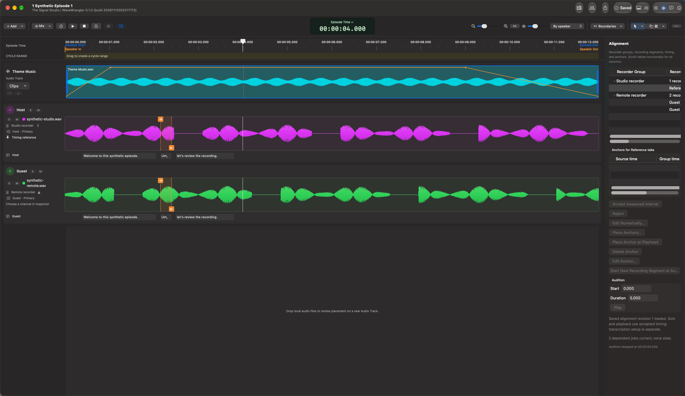

# Alignment

Alignment puts separately recorded speakers on a shared clock. It does not
rewrite the original media, and analysis never accepts its own proposal.

## Before analyzing

In **Recordings & Speakers**, check recorder groups, recording segments, speaker
assignments, Primary choices, and channels. Resolve unavailable or changed
sources first. Automatic matching needs shared audio from the same speaker,
not unrelated voices mixed together.

Choose **Use as Timing Reference** when you want a particular recorder to be
the reference for the next **Align Tracks** run. Selecting it does not move
audio or replace current accepted timing. A replacement reference requires
explicit acceptance and can reset downstream work; inspect the warning.

## Review automatic proposals

Open the timeline control bar's **More** menu and choose **Align Tracks** to
analyze eligible recordings, or use a recording's **Align** action for an
individual match. Review results in
**Review Tracks Alignment**.

Measured offset/rate proposals describe supported intervals, not a probability
that an entire recording is correct. Preview the proposed waveform, compare
the same events in the recordings, and listen.

**Accept measured interval** applies only the measured interval. Audio outside
it remains unplaced. **Extend to whole recording segment** is a separate,
warned extrapolation into unmeasured audio, not additional evidence.

Silence, repetitive sound, insufficient overlap, inconsistent delays, or a
recorder restart can prevent a useful match. Try a different shared speaker or
use manual timing. Microphone distance can also resemble a timing offset.

## Adaptive file timing

When one offset/rate cannot explain changing delay, automatic analysis can
propose experimental adaptive timing. **Adaptive review** also lets you request
it for a selected file.

The preview distinguishes locally supported timing runs from uncertain gaps
and ends. **Accept file timing and retain all audio** keeps unmatched audio using
estimated interpolation or extrapolation. Purple question marks mark estimates;
they are not verified synchronization.

Accepted adaptive timing uses pitch-preserving playback and affects all channels
of that file, not sibling files in its recorder group. Acceptance refuses
unsupported playback rates rather than silently dropping audio. Remove the
file-local correction before editing its recorder-group timing.

## Manual placement and anchors

**Place groups at source time** provides an initial manual placement without
acoustic analysis. For a timed recorder, drag its waveform, use the inspector's
nudges, or enter **Group move (ms)**; mapped recording segments move together.
Positive moves place the recorder later.

For matching events, mark a point on an already timed reference recording, then
use **Link to reference marker** on the same event in the target recording.
Use two pairs to fit offset and drift and choose **Apply anchors**. Staged
markers are not accepted timing until applied.

**Advanced / manual timing**, numeric timing, and **Place Anchors** support cases
where waveform matching is not practical. Treat recorder restarts as separate
segments; placement of one does not prove continuity of the next.

## Navigate and audition

Use **By recorder**, **By speaker**, **Overlay**, or **Speakers only** to inspect
the same timing in different layouts. **Normalize view** changes displayed peak
scale only. **Fit timeline**, zoom, and lane-height controls help reveal details;
**Follow Playhead** pages the visible timeline during playback.

Source listening choices control diagnostic audition, not the production mix.
Solo an untimed recording to hear its **original source time**, without cuts or
accepted-map activation. That makes neither the recording nor its siblings
aligned. **Compare Aligned Audio** is a short reference/target listening check,
not an export.

For the finished episode, use [Production Mix](mixer.md). Timing edits use Save
and Undo/Redo. If downstream text, boundaries, or cuts become stale, review
their status instead of assuming they were retimed.

[User guide](README.md)
