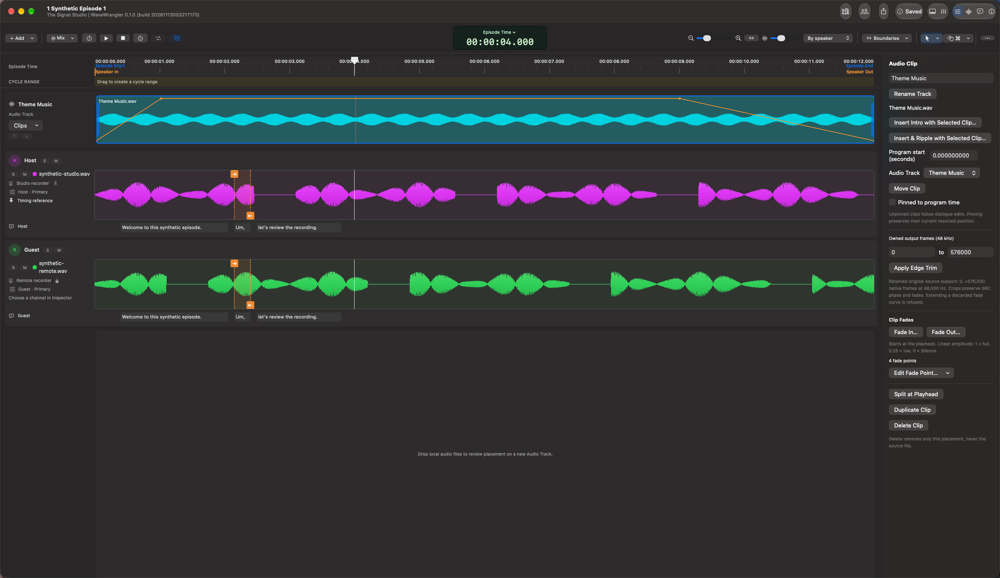

# Audio Clips, intros, and fades

Audio Clips add music, stings, and other supplemental audio without turning
them into speaker Primaries or changing the originals.

## Add and place audio

Choose **Add > Add Audio**, or drop local audio files onto the timeline canvas.
In a narrow window, **Add** is inside the control bar's **More** menu.
Review the destination **Audio Track**, **Program start (seconds)**, included
files, and order. Multiple files can be sequential or overlaid at the same
position. Import explicitly authorizes local read-only audio use.

**Ordinary placement never inserts time.** Sequential means the new clips play
one after another, not that existing dialogue is pushed aside.
Use **New Audio Track** when another lane will make the arrangement clearer.

Select a clip to move it, choose its Audio Track, trim its edges, split it at
the playhead, duplicate it, or delete the placement. Deleting a clip does not
delete the source file. Edge-trim fields use owned output frames at 48 kHz,
not seconds or the original recording's native frame numbers.

**Unpinned clips follow dialogue edits.** **Pinned to program time** preserves
the clip's resolved program position when surrounding time changes.

## Make room for an intro or insert time

Use **Insert Intro** or **Insert & Ripple** from the **Add** menu's inserted-time
controls, or the selected clip's inspector actions. Review the preview before
applying: insertion position, duration/end, and affected dialogue, clips, and
existing inserted regions.

An intro begins at the first relevant content boundary, not necessarily zero.
Its duration is independent of the selected clip's full length: a 40-second
music bed can have a 10-second lead-in, with speech continuing over its remainder.

**Move selected clip to insertion start** is an explicit choice, initially off.
Other pinned clips remain fixed. Existing region controls let you change or
remove inserted time; removing a region does not delete attached clip audio.
Review the resulting positions when shortening or removing a region.

Insertion changes the program arrangement, not the original alignment clocks,
transcript source timing, or recording bytes. Each Apply is undoable.

## Shape fades

Select a clip, place the playhead inside its audible trimmed interval, and
choose **Fade In** or **Fade Out** in the inspector. Set the duration or program
end and desired level. A fade begins from the evaluated level at its start.

Levels are linear amplitude: `1` is full level, `0.25` is one-quarter amplitude,
and **Silence** is exact zero. Repeat fades for a full-to-low-to-zero ending or
a rise, hold, and fade-out.

If a fade would replace existing points or change later automation, review and
explicitly approve that replacement. **Edit Fade Point** offers exact local
frame/fraction and level editing or point removal.

## Edit the visible automation

Drag a visible automation point horizontally to adjust its time; drag a level
segment vertically to change its level. Focused point handles support
Left/Right one-output-frame nudges, and level handles support Up/Down
`0.01` amplitude steps. Escape cancels an active gesture.

Moves, trims, splits, Save, and Undo/Redo retain the clip's curve and source
ownership. Review-only audio exposed by **Show cut** is not a destination for
clip placement, inserted time, or automation.

Use [Production Mix](mixer.md) mode to hear supplemental clips with the speakers
and processing; source audition is not the production arrangement.

[User guide](README.md)
