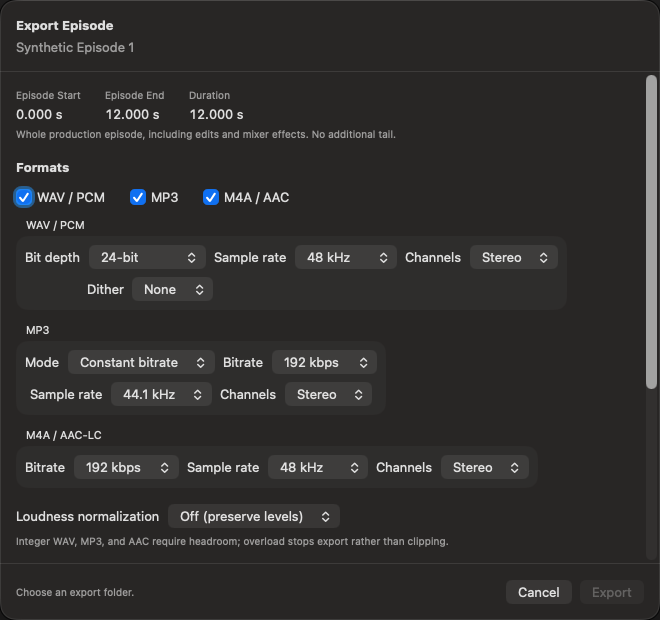

# Export an episode

Choose the toolbar's **Export** button or **File > Export** to deliver the
whole production episode as WAV, MP3, M4A/AAC-LC, or several formats in one job.
This is file export, not podcast hosting or feed publication.

## Review the production boundaries

The export sheet shows **Episode Start**, **Episode End**, and **Duration**.
It includes saved edits, supplemental Audio Clips, and mixer effects.
It does not export the current selection or append an extra effect tail.

Use the timeline's **Boundaries** menu to set or reset Episode Start/End.
It is also available in the control bar's **More** menu.
Automatic boundaries follow the available production content. If you want
room for an outro or effect decay, review the end explicitly and audition it.

**Speaker In/Out** is a separate pair of boundaries for spoken material.
**Restrict spoken tracks to Speaker In/Out** optionally silences dialogue outside
them while supplemental music can continue. **Edit Boundary Times** labels the
distinction: episode times use Timeline Time; speaker times use original aligned
time. Blank means Automatic.

Select **Production Mix**, then Play to check the result, rather than using
diagnostic source audition. Temporary mixer Solo/Mute is not an export setting.
Resolve source, timing, and effect readiness errors instead of expecting export
to substitute another recording.

## Choose formats

| Format | Available choices |
| --- | --- |
| WAV / PCM | 16-bit, 24-bit, or 32-bit float; 44.1, 48, 88.2, or 96 kHz; mono or stereo; optional TPDF dither for integer output. |
| MP3 | Constant bitrate or variable bitrate quality; 44.1 or 48 kHz; mono or stereo. |
| M4A / AAC-LC | Bitrate; 44.1 or 48 kHz; mono or stereo. |

Choose the combination your destination requires rather than treating a larger
file or sample rate as an automatic quality improvement.

## Optional loudness normalization

**Off (preserve levels)** leaves the mix's level unchanged. Integer WAV, MP3,
and AAC need headroom; overload stops export rather than silently clipping.
Float32 WAV can preserve finite levels above 0 dBFS with normalization off,
but other players may clip them.

**Podcast** targets -16 LUFS for stereo or -19 LUFS for mono with a -1 dBTP
ceiling. **Custom** lets you enter target LUFS and ceiling dBTP.
Normalization applies fixed gain, not limiting or compression. Peaks or the
+24 dB boost cap can prevent reaching the target; inspect the result/report.
This differs from per-recording [Auto Input Gain](mixer.md#auto-input-gain).

## Publication information and artwork

Set reusable defaults in **Show Info > Publication** and episode-specific values
in **Episode Info > Publication**. Episode fields can inherit show defaults,
override them, or explicitly omit a value. Private **Notes** are not exported.

Publication information includes public description, creator/artist, publisher,
copyright, genre, language, website, content rating, episode details, and artwork.
Not every field is supported by every output format; review and explicitly
accept the export sheet's listed metadata omissions before exporting.

**Metadata & Artwork (export only)** starts from resolved publication values.
Changes there affect the current export, not the saved show defaults.
You can choose, omit, or inherit artwork.

Publication artwork accepts JPEG/PNG up to 10 MB and 4,096 pixels per side;
embedded export artwork has a stricter 8 MiB limit and is not automatically
shrunk. Choose suitable artwork rather than assuming it will be resized.

## Choose a destination and finish

Set a **Base filename**, select **Choose Folder**, and check the displayed
filenames. Existing files are never replaced: choose a different name or
folder for a subsequent export.

WaveWrangler renders the production mix once into its private local temporary
storage, then creates and verifies every selected format there. Allow local disk
space for the uncompressed mix and encoded files, in addition to destination
space. Only completed, verified files are copied to the selected folder; each
copy is checked before its final filename appears.
Rendering uses independent effects in offline mode, larger processing blocks
where supported, and bounded preparation of the next audio window. It is not
paced to playback, but source preparation and effect complexity still affect
completion time; some effects use different processing quality when offline.
Cloud-provider metadata-only updates trigger another byte comparison rather
than rejecting an otherwise identical copy. Changed contents or file identity
still stop export; repeated metadata changes can also prevent publication.

Wait for completion and review the result and reported omissions. Lossy formats
may include encoder priming/padding, so their decoded duration is not exact
production timing. If canceling, wait for cleanup before closing; any files
already published remain in the destination. Listen to the delivered files
before distribution.

If destination transfer fails, the error shows a local temporary recovery folder
when verified files could be retained. These are not published deliveries and
temporary storage is not permanent: inspect and reverify them before use.
Already published files remain at the selected destination.

[User guide](README.md)
