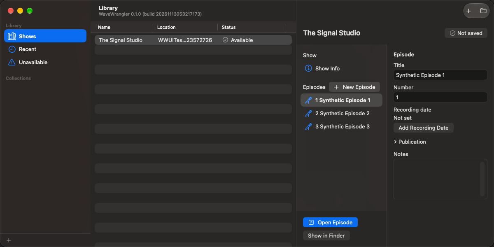

# Your first episode

This guide starts with a running development build. To build it, use the
[local quick start](../../README.md#build-and-open-locally).

## 1. Create a show and episode

Choose **File > New Show**, name the show, and choose where its document should
live. A folder that syncs is allowed, but cloud sync is separate from saving.
In **Library**, create an episode with **New Episode**.

Double-click the episode or choose **Open Episode**. Its dedicated editor stays
with that episode while Library remains available for browsing other shows.

## 2. Add recordings and choose your speakers

Open **Recordings & Speakers** in the episode toolbar, then **Import Sources**.
You can also drop recordings or a folder into the recordings area.
Review included files and any suggested recorder/speaker assignments before
importing. Import authorizes the included audio for use on this Mac after
identity verification; it does not rewrite or copy the original recordings.

Assign each speaker a recording and channel, then select that speaker's
**Primary**. Keep alternate recordings as **Backups**. Group recordings that
share the same recorder clock; use separate recording segments for restarts.
See [Library and recordings](library-and-recordings.md).

## 3. Align, review, and listen

In the timeline control bar, open **More** and choose **Align Tracks**.
Review the proposed measured or adaptive timing before accepting it. Refusals
are reasons to inspect the recordings, channels, and shared audio, not permission
to assume a match.

Use manual placement or anchors when automatic matching is unsuitable.
For a first inspection, Solo an untimed recording to hear its original source
time. That audition does not accept timing or make it production-ready.
See [Alignment](alignment.md).

## 4. Transcribe and make deliberate edits

Open **Settings > Transcription**, choose a model, and select **Download Model**.
Choosing a model alone never downloads it. Once all required Primaries and
their timing are ready, choose **Transcribe Tracks**.

Open **Transcript & Review** to inspect approximate word timing and suggested
fillers. Listen and adjust boundaries before using **Auto Cut** on a row or
the selection's scissors action. Use a speaker-only mute when you want to
silence one person without shortening the conversation.
See [Transcription and editing](transcription-and-editing.md).

## 5. Add music and balance the episode

Use **Add > Add Audio** for music or other supplemental audio. Placement
overlays the existing timeline; **Insert Intro** and **Insert & Ripple**
explicitly create time. Shape clip fades in the inspector or adjust the
visible automation.

Choose **View > Show Mixer**, adjust input gain and processing, and select
**Production Mix** in the control bar's **Mix/Source** menu before pressing
Play. Source audition does not include the same processing. See
[Audio Clips](audio-clips.md) and [Mixer](mixer.md).

## 6. Save and export

Check the toolbar's save status; **Saved** confirms the local show, not cloud
upload. Choose **Export**, review Episode Start/End, select formats and
normalization, and choose a destination. Existing destination files are not
overwritten.

Listen to the exported result as part of your delivery review.
See [Export](export.md) and [Saving and recovery](saving-and-recovery.md).

[User guide](README.md)
