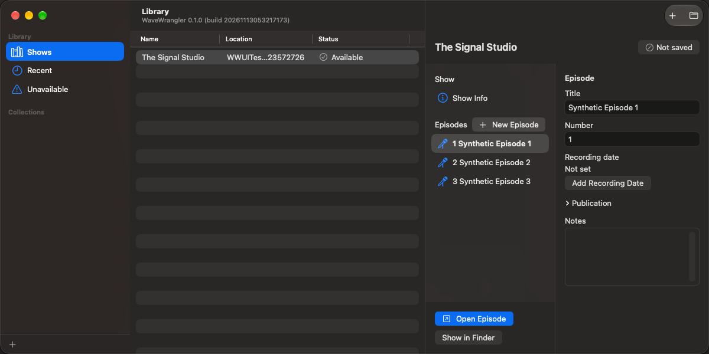
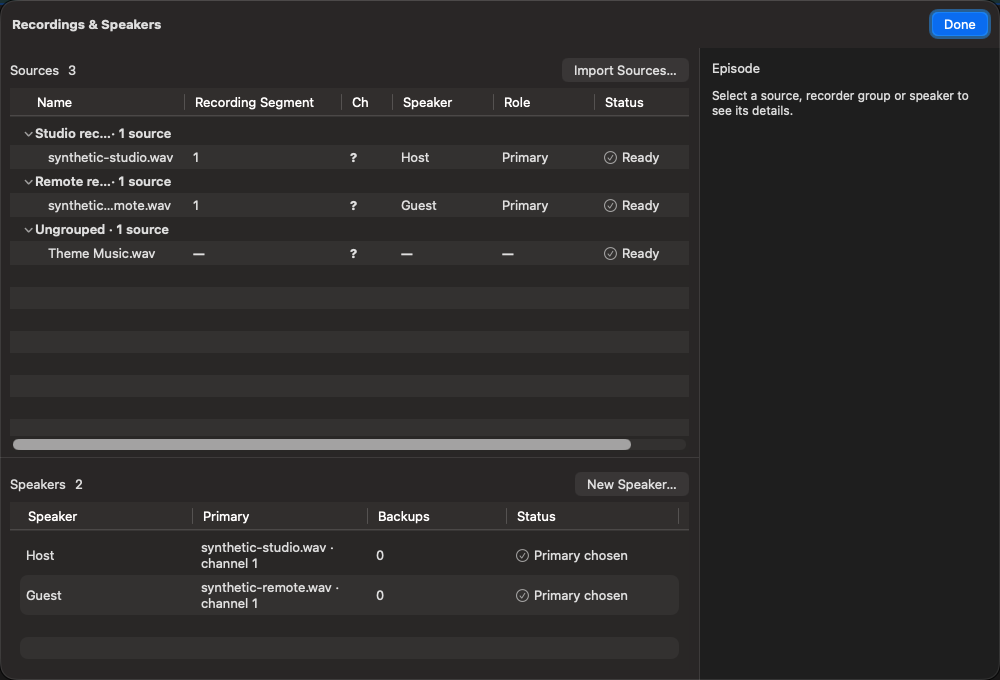

# Library and recordings

## Shows, episodes, and windows

**Library** is where you browse shows, organize collections, and create, rename,
reorder, or delete episodes. **Show Info** and **Episode Info** hold titles,
private notes, and reusable publication information.

Double-click an episode or choose **Open Episode** to edit it. Opening it again
brings its existing window forward; **Open Episode in New Window** creates
another view. Multiple episodes and shows can stay open together.

Each editor remains bound to its episode. Windows for the same show share its
document, Save state, and Undo history. **Close Show** closes the show through
the normal unsaved-changes decision. Removing a show from Library is not the
same as deleting its document or source recordings.

## Import recordings

Open **Recordings & Speakers**, then **Import Sources**, or drop recordings or
folders into its recordings area. In Import Review, check **Include** and review
recorder-group and speaker suggestions. Suggestions are provisional until you
accept them; filenames do not certify the recording's clock or speaker.

**Import explicitly authorizes included recordings on this Mac after identity
verification.** Originals remain referenced in place and unchanged. Keep them
available at their recorded locations, or use **Relink Source** when they move.
Older imports may offer **Review Recording Access** to approve unchanged
recordings together. A changed original needs relink/review, not blanket approval.

Audio availability and identity are checked again when needed. A cloud-only
file is not usable merely because its name appears in Finder; resolve the
displayed availability/access action before processing.

## Recorder groups and recording segments

A **recorder group** represents recordings sharing one device clock. A
**recording segment** is one continuous-clock span: start a new one when that
recorder stops and restarts. Separate recorders can restart independently.

Affine group timing moves the group's mapped recordings together. Adaptive
timing is different: it corrects only the selected file. Do not group unrelated
devices just because their recordings began at approximately the same time.

## Speakers, channels, and roles

Assign a **Speaker** and the intended **Channel**, then choose the speaker's
**Primary** recording/channel. Primary selection is the decision; there is no
extra confirmation step. Backups remain available for comparison and source
listening, but are not automatically used in transcription or production.

A verified mono recording has only one possible listening channel. For
multichannel recordings, choose the speaker's channel explicitly. One source
currently has one assigned speaker channel; do not assume every channel becomes
an independent speaker.

Use saved recorder/source definitions to reuse assignments across episodes.
Definitions store defaults, not copies of recordings, and do not silently
replace a chosen Primary.

## Recover unavailable sources

Select the recording and follow its status action: **Grant Access**, **Try Again**,
or **Relink Source**, as appropriate. Relinking compares the selected file before
you confirm it. Changed sources can invalidate timing, transcripts, and edits;
do not substitute an unrelated file simply to clear a warning.

See [Alignment](alignment.md) for timing and
[Saving and recovery](saving-and-recovery.md) for document and access recovery.

[User guide](README.md)
