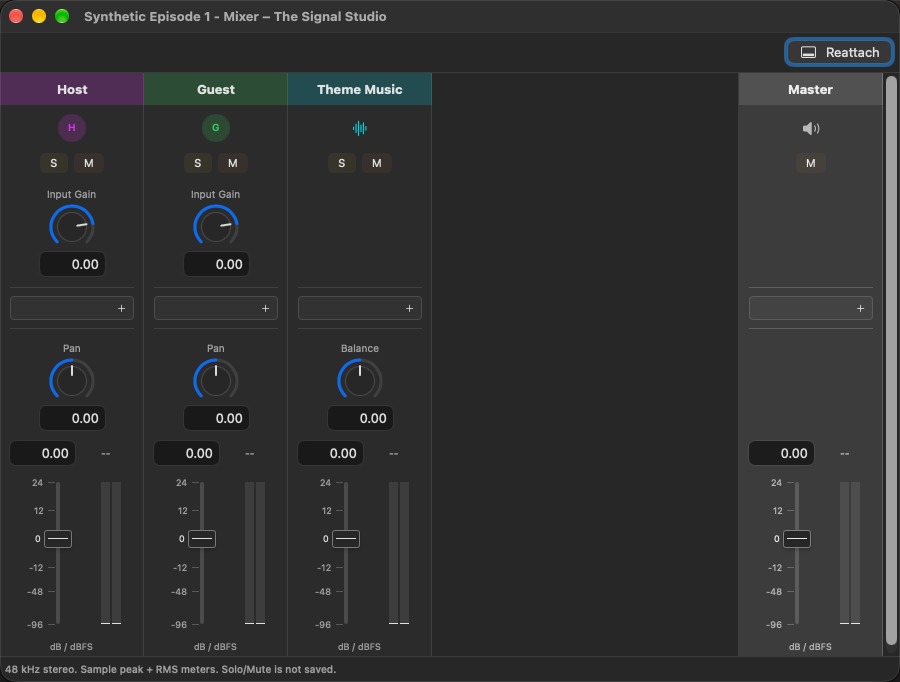

# Mixer and production listening

Select **Production Mix** in the control bar's **Mix/Source** menu, then press
Play when judging the episode you intend to export. **Source Audition** is for
inspecting recordings and alignment, not checking the production processing.
Switching modes stops the current audition; selecting a mode does not start it.

## Show or detach the mixer

Choose **View > Show Mixer** or the mixer control in the workspace.
Review and Mixer share the resizable bottom pane. **Detach mixer** or
**View > Pop Out Mixer** opens a native mixer window; **Reattach** returns it
to the editor. Option-clicking the toolbar's Mixer control also detaches it.

Each editor owns its mixer window and transport binding. Opening the mixer does
not start playback or change source-listening choices. Closing its originating
episode editor also closes the mixer and effect editors.

## Balance speakers and Master

There are strips for assigned speakers and supplemental Audio Tracks, plus a
pinned **Master** strip. The speaker's chosen **Primary** and channel identify
its input. Backups are not automatically mixed in.

**Input gain (dB)** is shared with the Recording inspector and precedes inserts.
It also affects diagnostic source listening, but does not change original media,
measured waveform data, or the input used for alignment and transcription.
Replacing a Primary uses the replacement recording/channel's own input gain;
the speaker's inserts, fader, and pan remain speaker settings.

Use the speaker fader and pan to balance the processed signal. Supplemental
Audio Tracks have their own inserts, output fader, and stereo **Balance**.
Master processing and output gain control the combined mix. These edits use
normal show Save and Undo/Redo; production controls are bypassed during source
audition.

## Auto Input Gain

Click a speaker strip's input-information button and expand **Auto Input Gain**,
or use the Recording inspector, then choose **Analyze and Set Input Gain**.
It analyzes that speaker's Primary channel locally and sets its input gain using
pause-gated RMS and an estimated true-peak ceiling.

This is a fixed gain adjustment, not compression, a limiter, or export loudness
normalization. A peak ceiling can prevent reaching the requested RMS target.
Use **Target Level Settings** to change the target; Undo restores the previous
gain. Analyze speakers individually and listen to the result.

## Audio Unit effects

Use **Add** to insert an Audio Unit, then **Open Editor** for its vendor interface
when available or the generic parameter editor otherwise. Insert actions support
ordering, bypass, and removal. Missing or unsupported units stay visible with
their saved state and an error rather than being silently omitted.

Compatibility is unit-specific. The current processing path uses mono speaker
inserts and a 48 kHz stereo Master/output; it is not a promise that every installed
Audio Unit works. Supplemental Audio Track inserts process a stereo clip sum.

Close effect editors before changing source or timing assignments. Save,
Undo/Redo, restart, and close capture native effect state. If capture is refused,
retry or use the explicitly confirmed discard choice; an open vendor editor is
not evidence that its latest state has been saved.

## Listening versus delivery

**Production Mix** includes production Primaries, saved cuts and speaker mute regions,
supplemental Audio Clips and fades, speaker processing, and Master processing.
It follows Episode Start/End and any enabled speaker-boundary restriction.

Mixer **Solo/Mute** is temporary production listening, not a saved export choice
or a source-role change. Use saved [speaker mute regions](transcription-and-editing.md#mute-only-one-speaker)
for an intentional region edit.

Diagnostic source listening omits production inserts and faders. Soloing an
untimed recording plays original source time without activating accepted timing
or applying cuts. Do not use that mode to approve the final edit.

Monitoring is buffered, not live microphone monitoring or zero-latency
processing. Meters describe prepared digital audio, not acoustic output.
For a delivery review, also inspect the [export](export.md) and its report.

[User guide](README.md)
