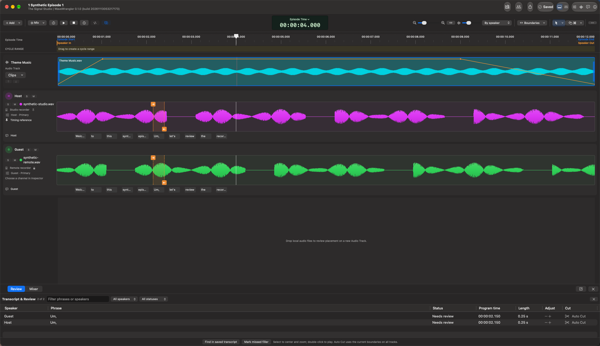

# Transcription and editing

Use words to find an edit, then use the audio to decide its boundaries.
Transcription, review, and cutting are separate actions.

## Set up local transcription

In **Settings > Transcription**, choose a model and explicitly select
**Download Model**. Selecting a model alone never starts a download. The app
verifies downloaded weights and rechecks them before transcription.

The choices are **Whisper Turbo Q5_0**, **Whisper Base English F16**,
**Whisper Small English F16**, and **Whisper Large-v3 Q5_0**. Turbo is the app's
default recommendation; a larger model is not a promise of better recognition.
Hardware, thread, and concurrent-worker settings affect subsequent jobs, not
saved transcripts or already queued work.

Downloads fetch model weights, not your audio. **Recordings and transcripts
are not uploaded for inference.** Once the selected model is available,
transcription runs locally. All choices use the app's English,
filler-preserving settings; recognition can still omit fillers or hallucinate.

## Transcribe the Primary tracks

Choose **Transcribe Tracks** in the timeline control bar's **More** menu.
Each required Primary needs a usable speaker channel, authorized source access,
and current accepted timing through the
analysis range. Muting a speaker for listening does not exempt it from readiness.
Hover the action for its current blocker when unavailable.

**Speaker In/Out** optionally limits the spoken analysis range; blank boundaries
include available aligned dialogue. Changing alignment can make explicit
boundaries stale and require review. These speaker boundaries are distinct from
the production **Episode Start/End** described in [Export](export.md).

Transcription publishes as one undoable episode update; cancellation or failed
verification does not save a partial transcript. Changing a source, Primary,
channel, timing, or other relevant input can make existing text inactive/stale
instead of silently moving it.

## Review words and fillers

Open **Transcript & Review** in the bottom pane or detach it into its own window.
Select a word or review row to locate its approximate interval on the waveform.
Double-click a row to audition its current segment.

New transcripts propose exact recognized `um`, `uh`, `erm`, and `er` tokens.
**Find in saved transcript** adds suggestions to existing current text without
running inference. This is not configurable phrase detection or automatic
silence removal. **Mark missed filler** creates a human proposal when recognition
misses something.

Listen using **Word**, **With context**, or **Loop**. Drag boundary handles, use
numeric fields, or make small nudges before deciding. Boundaries cannot cross
unsupported audio or neighboring review intervals in the same lane.

**Reviewed unchanged**, **Adjusted**, **Not a filler**, and **Needs review**
describe judgments, not accepted cuts. **Revert to detected** restores the
original suggested interval. **Uncertain recognition** flags suspicious repetition
for listening review; it is not an accuracy score.

**Word times are approximate.** Review against audible speech, particularly
consonants and overlapping voices. Raw recognizer text and its original timing
remain separate from your adjusted review.

## Cut time across the spoken tracks

Select a dialogue interval and use the scissors action, or choose **Auto Cut**
on a review row to cut that row's current boundaries. Despite its name, Auto Cut
is a deliberate action on that row, not permission to cut every suggestion.

A synchronized cut removes the shared interval across aligned spoken tracks,
keeping their conversation synchronized. Unpinned supplemental clips follow
their timeline anchors; pinned clips retain their program positions.

Use **Show cut** to reveal removed audio for review without restoring it.
**Restore** or Undo recovers it. Expanded removed audio is review-only: hide the
cut or choose a production position before placing clips or playing that range
as a mix.

## Mute only one speaker

For a cough, bleed, or unwanted sound that should not shorten the conversation,
select the interval in that speaker's waveform and use its mute action.
A saved speaker mute silences only that speaker's region; no time is removed,
and overlapping speakers stay in place. **Remove mute** or Undo restores it.

This is different from temporary mixer Mute/Solo, which changes listening only.
Neither cuts nor mute regions modify the original recordings. Inspect the result
in [Production Mix](mixer.md) mode before [exporting](export.md).

[User guide](README.md)
